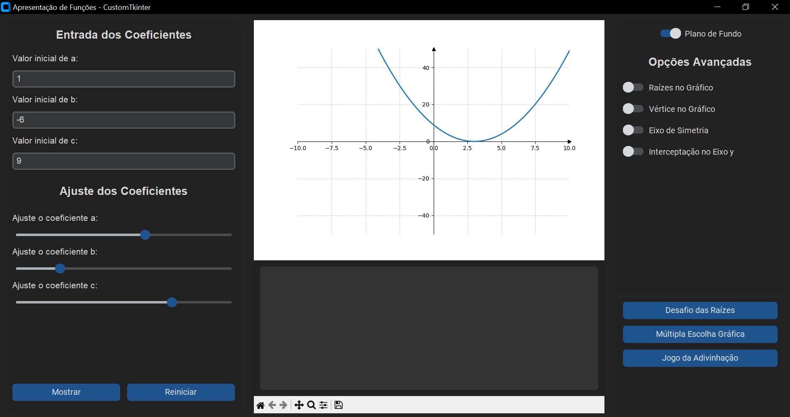
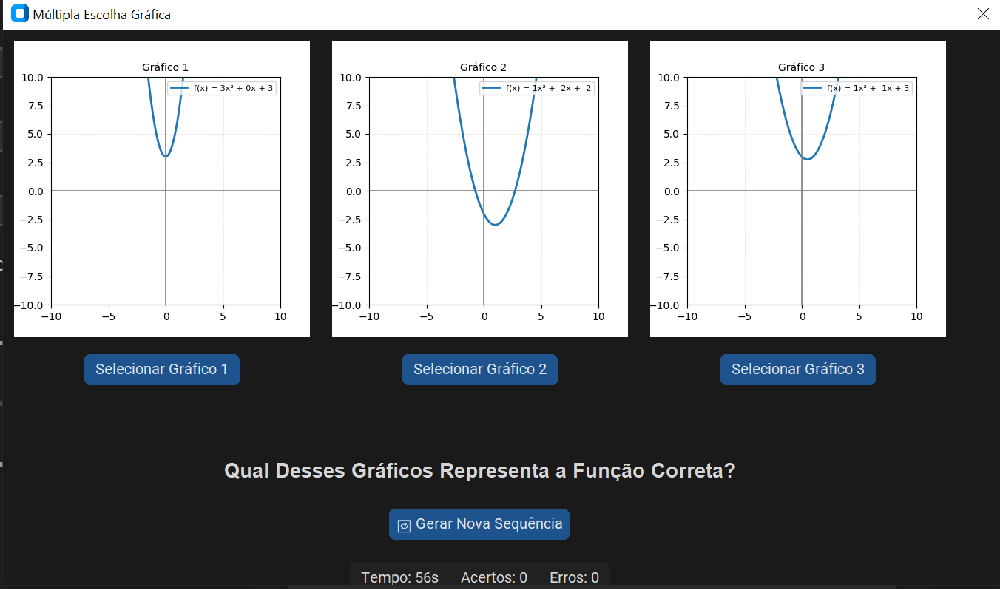

# 📈 Funções Quadráticas e Tecnologia Digital

  <strong>Tecnologia, interatividade e fundamentação didática para o ensino e a aprendizagem de funções quadráticas!</strong>

  

## 📚 Sobre o projeto

Este repositório apresenta uma proposta de desenvolvimento de uma **ferramenta digital educacional voltada ao ensino e à aprendizagem de funções quadráticas**. A ferramenta foi concebida para proporcionar um ambiente interativo de exploração matemática, permitindo a manipulação dinâmica dos coeficientes da função quadrática e a visualização, em tempo real, das transformações produzidas no gráfico da parábola.

Desenvolvida em **Python**, a aplicação integra representações algébricas e gráficas, mecanismos de feedback automático e atividades interativas, buscando favorecer a experimentação, a investigação e a construção de conhecimentos matemáticos.

## 🎯 Objetivo da pesquisa

A pesquisa tem como objetivo discutir a concepção e o desenvolvimento de uma ferramenta digital educacional para o ensino de funções quadráticas, considerando as contribuições da Gênese Instrumental para a organização de situações de ensino e a compreensão dos processos de apropriação tecnológica. Com a ferramenta buscou-se investigar como um recurso digital, inicialmente concebido como artefato tecnológico, pode ser progressivamente apropriado e transformado em instrumento de aprendizagem matemática.

## 📐 Objeto matemático: Funções quadráticas

O conteúdo matemático central da proposta são as **funções quadráticas**, representadas pela expressão geral:

$$
f(x)=ax^2+bx+c,\quad a\neq 0
$$

A ferramenta possibilita explorar diferentes propriedades e conceitos matemáticos, especialmente:

- **Coeficientes a, b e c:** influência dos parâmetros algébricos sobre o comportamento da parábola;
- **Concavidade:** identificação da orientação da parábola;
- **Raízes da função:** determinação dos pontos de interseção com o eixo das abscissas;
- **Discriminante (Δ):** análise da existência e da natureza das raízes;
- **Vértice:** identificação das coordenadas do ponto de máximo ou mínimo;
- **Eixo de simetria:** análise da simetria da representação gráfica;
- **Interseções com os eixos coordenados:** exploração das relações entre expressão algébrica e representação gráfica.

## 💻 Funcionalidades da ferramenta digital

O ambiente desenvolvido reúne recursos que permitem explorar conceitos matemáticos por meio de representações visuais e atividades interativas.

### 📊 1. Manipulação dinâmica dos coeficientes

O usuário pode inserir valores para os coeficientes a, b e c, tanto por campos de entrada quanto por controles deslizantes (*sliders*).

A cada alteração, o gráfico da função quadrática é atualizado automaticamente, permitindo observar as transformações na parábola.

### 📈 2. Visualização e análise gráfica

A ferramenta disponibiliza recursos para identificação e exploração de elementos importantes da função quadrática:

- Gráfico dinâmico da parábola;
- Coordenadas do vértice;
- Determinação das raízes;
- Valor do discriminante (Δ);
- Concavidade;
- Eixo de simetria;
- Interseções com os eixos coordenados.

### 🎮 3. Atividades interativas

O aplicativo também incorpora atividades lúdicas destinadas à exploração e à consolidação dos conhecimentos matemáticos:

- **Desafio das Raízes:** atividade voltada à identificação das raízes de equações quadráticas;
- **Múltipla Escolha Gráfica:** reconhecimento da representação gráfica correspondente a uma função;
- **Jogo da Adivinhação:** investigação dos coeficientes de uma função quadrática a partir de informações sobre o discriminante.

As atividades contam com recursos de acompanhamento do desempenho e feedback automático, possibilitando ao usuário verificar suas respostas.

## 🖼️ Interface e recursos interativos

Confira algumas telas da ferramenta digital desenvolvida:

  
   
  <em>Figura 1 – Tela inicial da ferramenta digital para exploração de funções quadráticas.</em>

  
   
  <em>Figura 2 – Opções interativas para realização de atividades matemáticas lúdicas.</em>

## 🎓 Aplicações educacionais

A proposta foi planejada considerando estudantes da **1ª série do Ensino Médio**, tendo em vista a importância das funções quadráticas no desenvolvimento do pensamento algébrico e da interpretação de representações gráficas.

Entre as possibilidades de utilização da ferramenta, destacam-se:

- Exploração das relações entre coeficientes e gráficos;
- Investigação das propriedades da função quadrática;
- Resolução de situações-problema;
- Experimentação matemática por meio de recursos digitais;
- Desenvolvimento da autonomia e do raciocínio lógico-matemático;
- Integração de tecnologias digitais às práticas pedagógicas.

A proposta também considera habilidades previstas na Base Nacional Comum Curricular (BNCC), especialmente EF08MA09, EF09MA09, EM13MAT302, EM13MAT402 e EM13MAT502.

## 🔬 Organização metodológica da proposta

O desenvolvimento da ferramenta está estruturado em dois momentos principais:

**Momento 1 – Investigações preliminares e estruturação do recurso digital**

- Etapa 1.1: Compreensão do objeto matemático;
- Etapa 1.2: Estruturação do objeto matemático e planejamento do recurso digital;
- Etapa 1.3: Definição tecnológica e estruturação dos conteúdos matemáticos.

**Momento 2 – Construção digital e análise a priori**

- Etapa 2.1: Prototipação e representações matemáticas;
- Etapa 2.2: Desenvolvimento e integração didática;
- Etapa 2.3: Validação do recurso e transformação instrumental.

Essa organização busca estabelecer uma conexão entre os conhecimentos matemáticos, as decisões tecnológicas e as hipóteses didáticas que orientam a utilização da ferramenta.

## 📄 Publicação científica relacionada

A proposta de desenvolvimento da ferramenta digital está fundamentada no seguinte artigo científico:

**SANTOS, Jailson França dos; ALVES, Francisco Régis Vieira. Funções Quadráticas e Tecnologia Digital: uma análise sob a perspectiva da Engenharia Didática e da Gênese Instrumental.**

*VIDYA*, Santa Maria, v. 46, n. 1, p. 107–127, 2026.

- **ISSN:** 2176-4603
- **DOI:** [10.37781/vidya.v46i1.5530](https://doi.org/10.37781/vidya.v46i1.5530).
- **Periódico:** [Revista VIDYA](https://periodicos.ufn.edu.br/index.php/VIDYA).
- **Acesso ao artigo:** [Consultar publicação científica](https://doi.org/10.37781/vidya.v46i1.5530).

## 📚 Contribuição científica e educacional

A pesquisa busca contribuir para as discussões sobre a integração de tecnologias digitais ao ensino da Matemática, destacando a importância de fundamentar pedagogicamente o desenvolvimento de ferramentas educacionais.

Ao articular Engenharia Didática, Teoria das Situações Didáticas e Gênese Instrumental, a proposta apresenta possibilidades de planejamento e análise de recursos digitais, considerando não apenas suas funcionalidades técnicas, mas também os processos de apropriação e construção do conhecimento matemático.

Ressalta-se que as potencialidades de aprendizagem apresentadas constituem hipóteses didáticas formuladas nas fases iniciais da Engenharia Didática, cuja efetivação depende de investigações empíricas em contextos reais de ensino.

## 👨‍💻 Autores e pesquisadores

**Jailson França dos Santos**  
Autor e desenvolvedor da proposta.

**Francisco Régis Vieira Alves**  
Coautor e supervisor da pesquisa de pós-doutorado.

## 📩 Contato

Para dúvidas, informações, sugestões ou contribuições relacionadas à pesquisa e à ferramenta digital, entre em contato:

**Jailson França dos Santos**

📧 [jailson.santos@ufob.edu.br](mailto:jailson.santos@ufob.edu.br)

---

  <strong>Tecnologia e fundamentação didática na construção de novas possibilidades para a Educação Matemática!</strong>

